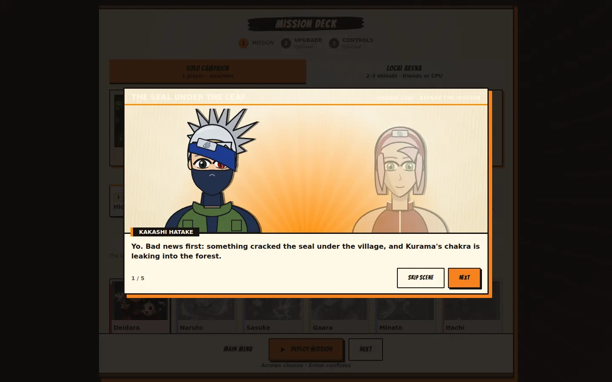
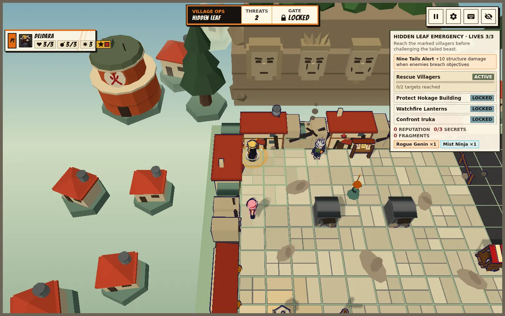
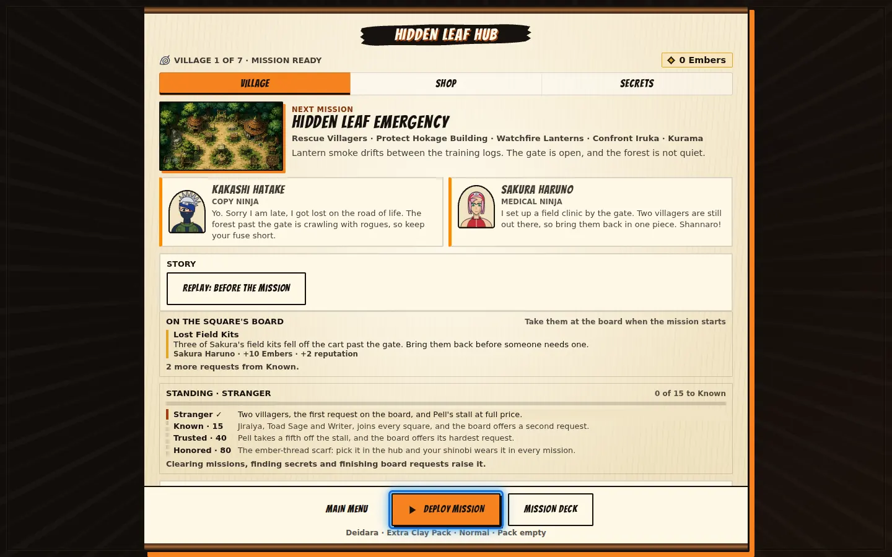
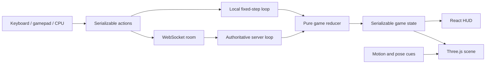

# Explosive Shinobi Arena

A fast 3D grid-bomber game set in the world of Naruto: a seven-village
campaign, couch battles, CPU opponents, and private online rooms. Built for the
browser with React, TypeScript, and Three.js.

**[Play the game](https://bomberman-zuqb.onrender.com)**


## Highlights

- Six fighters (Naruto, Sasuke, Gaara, Minato, Itachi, Deidara) with their own
  bombs, passives, movement styles and signature jutsu.
- A seven-village campaign on 50x50 maps with secret rooms, defense waves,
  mini-bosses and a tailed beast in every boss arena.
- Each mission starts in a living village square. Talk to Kakashi, Sakura,
  Temari, Mei, Jiraiya and more, take requests from the board, and shop
  mid-mission. Each square rebuilds from ruins to a festival as you help.
- Story scenes with portraits, a Secrets tracker with set rewards, standing
  tiers and village scarves.
- Training dojo, local arena with CPU opponents, and private online co-op and
  versus rooms.
- Deterministic rules shared by browser matches, CPU play, replays, and the
  authoritative online server.
- Anime cel-shaded characters, tailed beasts, jutsu effects and village
  landmarks, all drawn in code.
- Responsive keyboard, gamepad, and touch controls with accessibility options:
  reduced motion, high contrast, and flash-safe effects.

## Screens

| Mission Deck | Story scene |
| --- | --- |
|  |  |
| **Village square** | **Village hub** |
|  |  |
| **Live arena** | |
|  | |

The complete modes, characters, missions, bosses, power-ups, and progression
systems are documented in the [product specification](docs/EXPLOSIVE_SHINOBI_ARENA_PRD.md).

## Animation And Models

Every character is built at runtime from one look in
`src/content/animeCast.ts`: hair, outfit, headband mark, face marks and
accessories. The game turns it into one merged cel-shaded body and one ink
outline. The tailed beasts, jutsu effects and village landmarks are built the
same way, from shared recipes, so no character meshes are downloaded. A
separate cue store animates movement, attacks, hits, ultimates and knockouts
without changing deterministic game state.

AI-assisted images were used for visual references and menu artwork, then
selected, cropped, compressed, and integrated manually. No runtime AI or
image-to-3D generation is used. See the
[rendering and model pipeline](docs/ARCHITECTURE.md#rendering).

## Performance

Production profiling drove the optimization work: fixed-step simulation,
interpolated motion, selector-based React updates, instanced scenery, cached
resources, pooled lights, shader warmup, capped pixel ratio, and lazy loading.

Recorded profiling reduced a versus scene from **445 to 67 draw calls** and
scene updates from roughly **30 to 5-7 components per simulation tick**. No
shader compiles after a match starts. Render
budgets, shader reuse, deterministic rules, and browser flows are protected by
automated tests. Read the [performance design](docs/ARCHITECTURE.md#performance-constraints).

## System Design



Campaign, training, and local battles run the reducer in the browser. Online
rooms run the same rules on the server; browsers send player intent and receive
validated snapshots. The renderer never owns gameplay state, so visual
animation cannot change a match outcome.

Read [the system design](docs/ARCHITECTURE.md) for state ownership, the online
room lifecycle, rendering boundaries, and performance constraints.

## Stack

| Area | Technology | Role |
| --- | --- | --- |
| UI | React 18, TypeScript, MUI | Screens, HUD, controls, accessibility |
| 3D | Three.js, React Three Fiber | Arena, models, effects, animation |
| Game core | Pure reducer, seeded RNG | Deterministic rules shared across modes |
| Online | Node.js, WebSocket (`ws`) | Authoritative rooms and reconnects |
| Build | Vite, esbuild | Client bundles and server build |
| Quality | Vitest, Testing Library, Playwright, ESLint | Logic, rendering, browser, and static checks |

## Run Locally

Requires Node.js 22.

```bash
npm install
npm start
```

Start private online rooms in a second terminal:

```bash
npm run server
```

```bash
npm run lint
npm run typecheck
npm test
npm run build
npm run test:e2e
```

CI runs all of these on every push and pull request to `main`.

## Documentation

- [System design, rendering, networking, and optimization](docs/ARCHITECTURE.md)
- [Full product and feature specification](docs/EXPLOSIVE_SHINOBI_ARENA_PRD.md)

## Credits

- Fonts: [Bangers](https://github.com/googlefonts/bangers) and a 16-kanji subset
  of [Yuji Boku](https://github.com/Kinutafontfactory/Yuji), both under the SIL
  Open Font License 1.1. The licences are in [public/fonts](public/fonts).
- Characters, villages, models, effects and portraits are drawn in code by the
  game. No art, models, logos, music or voices from the show or its games are
  included.

## License

MIT for the code. This is an independent, non-commercial fan project. Naruto
and its characters, names and village marks belong to Masashi Kishimoto,
Shueisha and their licensees. No affiliation or endorsement is implied.
