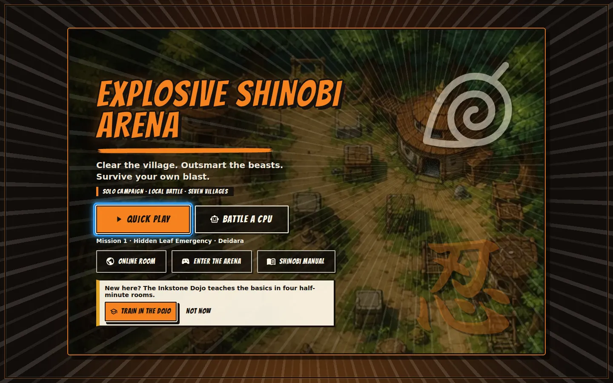
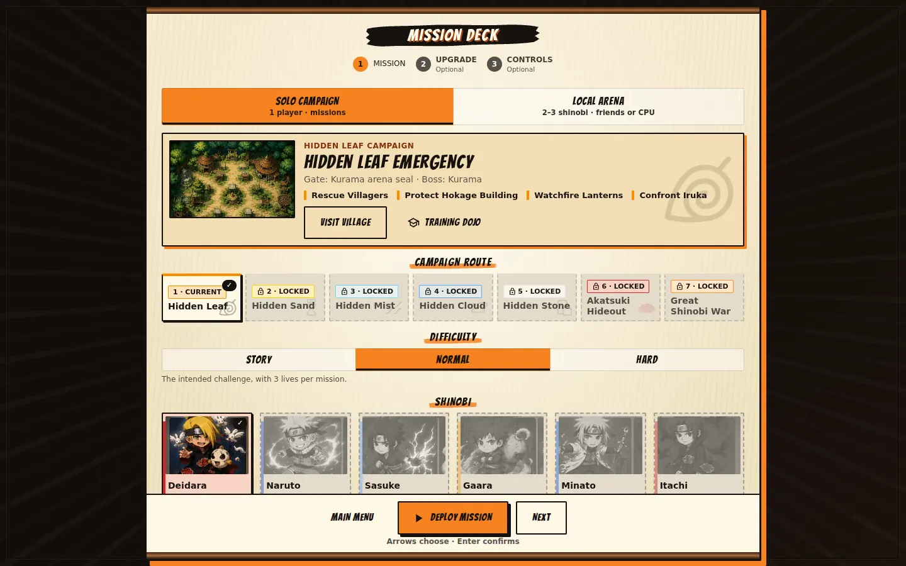
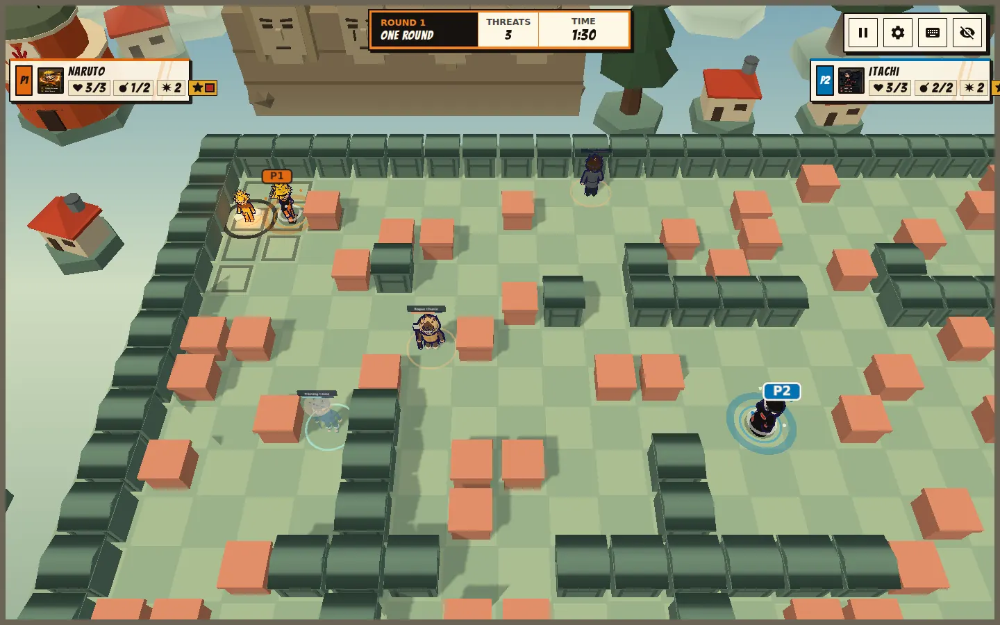
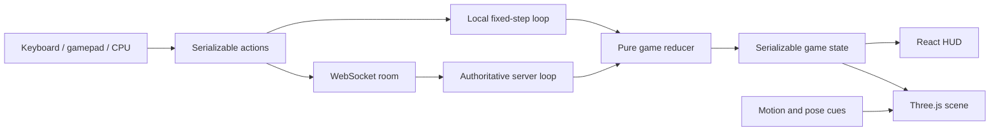

# Explosive Shinobi Arena

A fast 3D grid-bomber game with a shinobi-inspired campaign, couch battles,
CPU opponents, and private online rooms. Built for the browser with React,
TypeScript, and Three.js.

**[Play the game](https://bomberman-zuqb.onrender.com)**



## Highlights

- Six fighters with distinct bombs, passives, movement styles, and ultimates.
- Solo campaign, training dojo, local arena, and private online co-op/versus.
- Deterministic rules shared by browser matches, CPU play, replays, and the
  authoritative online server.
- Procedural cel-shaded characters, enemies, bosses, pickups, and effects.
- Responsive keyboard, gamepad, and mobile controls with accessibility options.

## Screens

| Mission Deck | Live arena |
| --- | --- |
|  |  |

The complete modes, characters, missions, bosses, power-ups, and progression
systems are documented in the [product specification](docs/EXPLOSIVE_SHINOBI_ARENA_PRD.md).

## Animation And Models

The shipping 3D models are assembled at runtime from poseable Three.js
primitives. Shared recipes, merged geometry, toon lighting, and back-facing ink
hulls create the minimal retro-anime look without downloading character meshes.
A separate cue store animates movement, attacks, hits, ultimates, and knockouts
without changing deterministic game state.

AI-assisted images were used for visual references and menu artwork, then
selected, cropped, compressed, and integrated manually. No runtime AI or
image-to-3D generation is used. See the
[rendering and model pipeline](docs/ARCHITECTURE.md#rendering).

## Performance

Production profiling drove the optimization work: fixed-step simulation,
interpolated motion, selector-based React updates, instanced scenery, cached
resources, pooled lights, shader warmup, capped pixel ratio, and lazy loading.

Recorded profiling reduced a versus scene from **445 to 115 draw calls** and
scene updates from roughly **30 to 5-7 components per simulation tick**. Render
budgets, shader reuse, deterministic rules, and browser flows are protected by
automated tests. Read the [performance design](docs/ARCHITECTURE.md#performance-constraints).

## System Design



Campaign, training, and local battles run the reducer in the browser. Online
rooms run the same rules on the server; browsers send player intent and receive
validated snapshots. The renderer never owns gameplay state, so visual
animation cannot change a match outcome.

Read [the system design](docs/ARCHITECTURE.md) for state ownership, the online
room lifecycle, rendering boundaries, and performance constraints.

## Stack

| Area | Technology | Role |
| --- | --- | --- |
| UI | React 18, TypeScript, MUI | Screens, HUD, controls, accessibility |
| 3D | Three.js, React Three Fiber | Arena, models, effects, animation |
| Game core | Pure reducer, seeded RNG | Deterministic rules shared across modes |
| Online | Node.js, WebSocket (`ws`) | Authoritative rooms and reconnects |
| Build | Vite, esbuild | Client bundles and server build |
| Quality | Vitest, Testing Library, Playwright, ESLint | Logic, rendering, browser, and static checks |

## Run Locally

Requires Node.js 22.

```bash
npm install
npm start
```

Start private online rooms in a second terminal:

```bash
npm run server
```

```bash
npm run lint
npm test
npm run build
npm run test:e2e
```

## Documentation

- [System design, rendering, networking, and optimization](docs/ARCHITECTURE.md)
- [Full product and feature specification](docs/EXPLOSIVE_SHINOBI_ARENA_PRD.md)
- [Archived character model experiments](public/models/characters/README.md)

## License

MIT. This is an independent fan project; no affiliation or endorsement is
implied.
