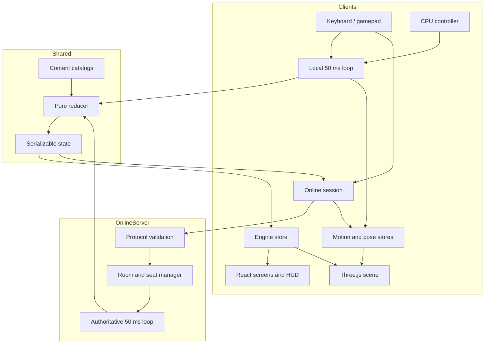
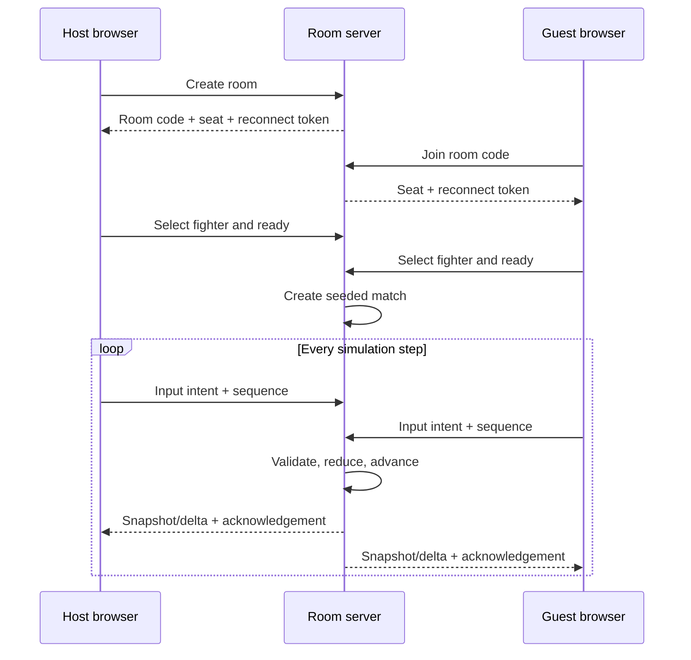

# System Design

Explosive Shinobi Arena separates game rules from input, networking, and
rendering. The same deterministic simulation powers campaign, training, local
battles, CPU players, replays, and online rooms.

## Design Goals

- One source of truth for every match.
- Repeatable outcomes from the same seed and action stream.
- Smooth rendering without tying game speed to frame rate.
- Untrusted online clients that send intent, never game state.
- Content that can grow without duplicating engine rules.

## Top-Level Design

## State Ownership

| Mode | Authoritative state | Input path |
| --- | --- | --- |
| Campaign | Browser engine loop | Keyboard or gamepad |
| Training | Browser engine loop | Keyboard or gamepad |
| Local Arena | Browser engine loop | Humans and CPU controllers |
| Online Arena | Node room server | Validated WebSocket intent |

The reducer owns players, bombs, flames, pickups, monsters, bosses, hazards,
objectives, fog, the round clock, and results. React and Three.js only present
that state. Visual effects cannot award damage, move a player, or finish a
mission.

## Local Match Flow

1. The Mission Deck creates a serializable `GameConfig` and seed.
2. `engineLoop.ts` accepts movement and action intent.
3. It accumulates elapsed time and advances the reducer in fixed 50 ms steps.
   Frame gaps are capped, and no more than four simulation steps run per frame.
4. CPU controllers inspect state and submit the same actions as human players.
5. The engine store publishes once per display frame.
6. Narrow selectors update only the HUD or scene leaves whose data changed.
7. Motion tracks interpolate positions between simulation steps. Pose cues
   animate plants, hits, ultimates, and knockouts outside the reducer.

Seeded randomness is the only randomness inside a match. This keeps tests,
replays, CPU simulations, and online execution reproducible.

Power-up rolls preserve that determinism. When an arena crate contains a
pickup, all eight shared categories have equal odds for every fighter. Campaign
rewards expose those same eight categories with equal slots, replacing
equivalent generic entries with the active fighter's signature pickup. Authored
Chakra Scrolls, secrets, and rare Character Fragments remain separate from
ordinary random drops.

Basic and ultimate reach are independent player stats. `BlastRangeUp` changes
ordinary bombs, while `UltimateRangeUp` is added only when the engine creates
an ultimate bomb. The optional ultimate bonus defaults to zero when an older
replay or network snapshot does not contain it. Kirin already spans its full
row and column, so its bonus widens the one-third-health lightning perimeter;
the other ultimates extend their blast rays.

## Character Ability Resolution

Signature abilities are simulation rules, not renderer effects. Bomb creation,
movement, blast geometry, damage, and movement locks resolve in `src/engine/`.
The browser renderer reads the resulting bomb and actor state to draw matching
models and effects.

`characterAbilities.ts` is the shared geometry source for Naruto's Shadow
Clone Barrage. After two seconds, traversable cells in the eventual blast
footprint become clone blockers. The barrage owner's player ID is carried on
every blocker: that owner can move through the formation, while other players,
monsters, and bosses are immobilized. A different Naruto is still an opponent
and remains affected.

Minato's passable kunai marker lives on `PlayerState`. Using his ultimate
consumes that marker and creates the bomb there. With no marker, the reducer
uses Minato's current cell. Because both mechanics live in serializable state
and the shared reducer, local and server-authoritative matches use identical
rules.

## Campaign Maps

Each village has two authored maps, bundled with the client and the server.
Local Arena and online arena rooms play the 35x35 arena map in
`public/maps`. Solo and co-op missions play the 50x50 campaign map in
`public/maps/campaign`. `content/campaignLayouts.ts` places the mission on
that map: player spawns, rescue targets, the defense structure, enemy
burrows, the mini-boss gate, the boss arena and the three secret rooms.

Campaign maps use three extra cell marks. A cracked wall (`C`) is a secret
room's door: it breaks like a crate but drops nothing. A hidden passage (`H`)
is open floor drawn as a seamed false wall. An arena gate (`G`) stays a wall
until the mini-boss gate is cleared. The first player to step into a secret
room reveals its scroll or fragment, or wakes its elite Zetsu at the far end.
When the boss unlocks, the reducer opens the arena gates, and the boss enters
at the arena's centre. The renderer draws doors and gates by shape with the
wall material, so they compile no new shader.

## Village Square

Every campaign mission starts in its village's square: the open 10x8
entrance district that all seven campaign maps share. The square is the hub
inside the map. `content/villageSquare.ts` holds its contract and
`engine/villageSquare.ts` its rules:

- No bomb can be dropped inside it, blasts stop at its edge, enemies never
  enter it and lose track of a player inside, and boss hazards and wave
  entries skip it. Its props (the two villagers, the request board, the
  merchant's stall, the shrine and the gate) block movement like pillars.
- Next to a prop, the bomb key, pad A or the touch bomb button talks, trades or
  reads instead of dropping a bomb. In solo play an open panel pauses the match.
- The request board offers optional goals (collect marked keepsakes, break
  marked crates, find a secret, defeat enemies, finish without a fall). The
  stall sells the hub's consumables mid-mission. Both are engine actions
  (`ACCEPT_REQUEST`, `CAMPAIGN_PURCHASE`) that work while paused, so a
  recorded match replays the same way.
- Requests and the stall exist only in solo campaign. The app builds
  `GameConfig.village` from the save before `INIT` (standing tier, Embers,
  offered requests, rebuild stage, scarf). Co-op and online rooms have no
  `village` config, so they get the square's rules and people but not its board
  or stall. Online clients cannot send either action.

Progression lives in `src/story/`. Each village's reputation rises with
mission clears, new secrets and finished requests. **Standing** is the sum over
all villages. Its tier (Stranger, Known 15, Trusted 40, Honored 80) brings
Jiraiya to every square, a stall discount, more requests and an ember-thread
scarf. A village's own reputation sets its **rebuild stage**: damaged until
first cleared, then rebuilt, thriving and festival. Between missions the hub
(`view/HubScreen`) has three tabs:

- **Village:** the canon villagers, standing, rebuild stage and the board.
- **Shop:** the shop.
- **Secrets:** each village's three secrets with a rough location and reward.
  Finding all three pays Embers and unlocks that village's scarf.

The first deploy to a village, from the hub or the Mission Deck, plays a short
story scene with portraits. The scene can be skipped and replayed from the
hub. The save is versioned (`STORY_PROGRESS_VERSION`, now 6) and migrates
older saves forward.

## Online Room Flow

The browser never sends a player ID, reducer action, or replacement state.
`src/network/protocol.ts` validates message shape and limits. The server assigns
seats, applies allowed intent, owns round advancement, and sends snapshots with
sequence acknowledgements.

A short disconnect pauses the room. A reconnect token restores the seat and
forces a full snapshot before play resumes. Rooms live in memory, so the current
deployment must use one server instance. Matchmaking, spectators, persistent
rooms, rollback prediction, and multi-region routing are future systems.

## Rendering

The renderer has three layers:

- **Static world:** floor, walls, crates, and stage landmarks use instanced
  meshes.
- **Actors:** fighters, enemies, bosses, bombs, pickups, and objectives use
  shared geometry and materials where possible.
- **Presentation:** HUD, labels, fog, telegraphs, camera framing, animation
  cues, and accessibility settings.

The simulation stores decimal grid coordinates. The scene maps `(x, y)` to
Three.js `(x, 0, y)` and samples motion tracks each frame. This makes movement
look continuous while collisions remain deterministic.

### Model Pipeline

Every humanoid is a **cast figure**. That covers the six fighters, the seven
enemy kinds, the mini-boss gate guards, the square's canon villagers and
Naruto's shadow clones. `content/animeCast.ts` describes each character once:

- hair and outfit presets;
- colours;
- the headband's village mark and how it is worn;
- face marks, eye marks and accessories.

`scene/cast/` turns a look into one merged, vertex-coloured body plus one welded
ink line, so each figure costs two draw calls, cached per look. Faces, headband
plates (the marks in `content/villageSymbols.ts`) and prints such as the
Akatsuki clouds come from one canvas atlas, painted once. `CastPrewarm` builds
every look a match can need during the countdown. Shadow clones reuse Naruto's
figure with a chakra glow, a uniform on a pooled material, so they need no new
shader.

Each tailed beast
(`scene/beasts/`) is drawn as the anime shows it, with the right number of
tails, and wears the fighters' toon bands and ink line. Pickups and objectives
use merged vertex-colored bodies.

Signature jutsu (`scene/jutsu/`) are render-only. Each bomb kind maps to its
jutsu: smoke puffs, Rasenshuriken blades, forked lightning, sand, clay blasts,
crows and black flames, tomoe, and the yellow flash. The blast draws them on a
few extra instanced layers that share the flame's program. Every blast keeps
the same floor shockwave and ring in its danger colour, and spins and crackles
stay at or under three beats a second.

The cel-shaded finish has two passes:

1. A shared three-band toon texture quantizes light.
2. One welded, back-facing hull per fighter expands along vertex normals to
   create a stable dark outline.

No mesh files are downloaded. Everything is built in code from shared
recipes, which keeps scale, silhouettes, animation, load time and draw-call
cost predictable. Nothing is copied from the show or its games. The look is
drawn by the game from the cast data.

### Villages

Each village has its famous places on the skyline, built by
`scene/village/heroLandmarks.ts`:

- **Hidden Leaf:** the Hokage Rock faces and the round residence with 火.
- **Hidden Sand:** the Kazekage dome.
- **Hidden Mist:** the water and the tower.
- **Hidden Cloud:** the tower on its peak.
- **Hidden Stone:** the spire.
- **Akatsuki hideout:** the Demonic Statue.
- **War front:** the alliance tents.

The kanji are the game's own brush strokes, drawn as geometry, not text. The
square's dressing follows the rebuild stage: rubble and soot, then fresh
timber, then banners and lit lanterns, then a festival. The walking extras are
render only. They step aside for players and never block anything. Wall shapes
vary by village but share one material.

### Portraits and UI

Story scenes, the talk panel and the hub's villager cards use SVG portraits
(`view/portraits/`) drawn from the same cast looks. The menus and HUD use the
theme tokens in `src/index.css`:

- scroll-paper panels, brush headers and village marks;
- two bundled OFL fonts: Bangers, plus a Yuji Boku subset of 16 kanji. See
  `public/fonts/`.

The HUD keeps fixed band sizes, so camera framing is unchanged.

## Performance Constraints

- Simulation: fixed 50 ms steps outside React.
- React: selector-based subscriptions and stable render-state identity.
- GPU: instancing, merged geometry, pooled materials, and cached textures.
- Shaders: a fixed pool of five point lights and countdown warmup.
- Canvas: no antialiasing, device pixel ratio capped at 1.35, demand rendering
  while paused or showing results.
- Loading: route-level lazy loading, a separate Three.js vendor chunk, and
  static first paint.
- Camera: gameplay is framed against measured HUD safe areas.

Measured on production builds (versus, 1366x768): draw calls fell from 117
to 67 when every figure became one merged body and one ink line. Frame time
stayed level, and no shader compiles after the match starts.

Performance work is checked on production builds. Useful signals are draw calls,
triangles, shader programs, late compiles, main-thread long tasks, React render
counts, and first-load timing. Reducer tests verify rules; scene tests verify
resource and rendering contracts; Playwright exercises real browser flows.

## Quality

CI runs on every push and pull request to `main`: lint, type check, unit and
scene tests, the client build, the server build, and Playwright browser tests
against the built client and server. Every rule change bumps
`REPLAY_VERSION` (now 10), and `SIMULATION_VERSION` follows it. The online
server rejects clients on another simulation version, so old tabs cannot join
rooms with different rules.

## Main Modules

| Path | Responsibility |
| --- | --- |
| `src/engine/` | State, reducer, character abilities, hazards, campaign, and seeded randomness |
| `src/ai/` | CPU decision-making through ordinary engine actions |
| `src/content/` | Data-driven stages, fighters, missions, enemies, bosses, the anime cast, village marks, the square, requests, secrets, and story scenes |
| `src/story/` | Save, migrations, Embers, rewards, standing and rebuild stages |
| `src/hooks/engineLoop.ts` | Local fixed-step scheduler |
| `src/hooks/engineStore.ts` | State publication and selector subscriptions |
| `src/hooks/motionStore.ts` | Display interpolation tracks |
| `src/hooks/cueStore.ts` | Render-only animation cues |
| `src/network/` | Online protocol, browser session, reconnects, and replay |
| `server/` | Authoritative rooms, ticks, rate limits, and health check |
| `src/view/GameScreen/` | Match shell, HUD, camera, and 3D renderer |
| `src/view/GameScreen/scene/` | Instancing, lights, warmup, models, ink, and telegraphs |
| `src/view/GameScreen/scene/cast/` | Cast figures: atlas, merged bodies, ink lines, prewarm, scarves |
| `src/view/GameScreen/scene/beasts/`, `jutsu/` | Tailed beasts and signature jutsu effects |
| `src/view/GameScreen/scene/village/` | Landmarks, the square's dressing and rebuild stages, extras |
| `src/view/GameScreen/village/` | The square's talk, board, stall, shrine and gate panels |
| `src/view/HubScreen/`, `src/view/portraits/` | Hub tabs, story scenes and SVG portraits |
| `src/theme/`, `src/index.css` | Theme tokens, fonts and village marks for menus and HUD |

## Deployment

Vite builds the static browser client. The Node service hosts WebSocket rooms
and `/healthz`. In `render.yaml`, the client receives the server URL through
`VITE_GAME_SERVER_URL`, and the server receives the allowed browser origin.
The online service must remain single-instance until rooms move to shared
storage or use sticky routing.
