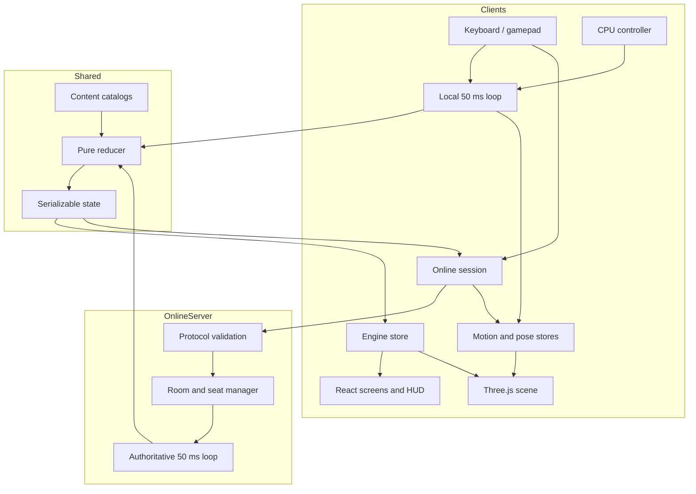
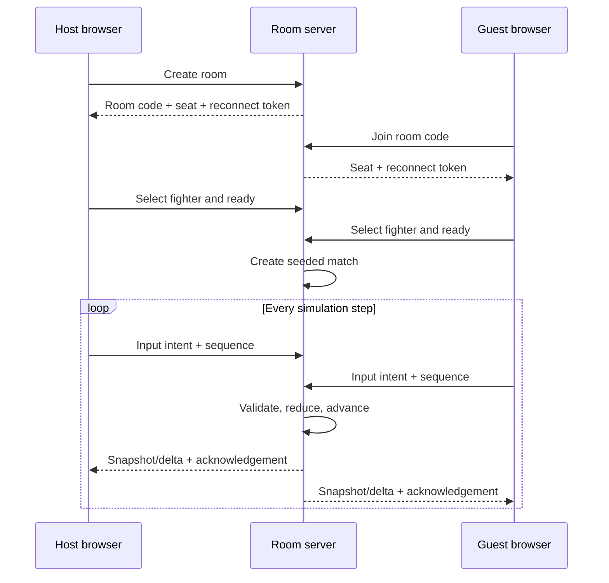

# System Design

Explosive Shinobi Arena separates game rules from input, networking, and
rendering. The same deterministic simulation powers campaign, training, local
battles, CPU players, replays, and online rooms.

## Design Goals

- One source of truth for every match.
- Repeatable outcomes from the same seed and action stream.
- Smooth rendering without tying game speed to frame rate.
- Untrusted online clients that send intent, never game state.
- Content that can grow without duplicating engine rules.

## Top-Level Design

## State Ownership

| Mode | Authoritative state | Input path |
| --- | --- | --- |
| Campaign | Browser engine loop | Keyboard or gamepad |
| Training | Browser engine loop | Keyboard or gamepad |
| Local Arena | Browser engine loop | Humans and CPU controllers |
| Online Arena | Node room server | Validated WebSocket intent |

The reducer owns players, bombs, flames, pickups, monsters, bosses, hazards,
objectives, fog, the round clock, and results. React and Three.js only present
that state. Visual effects cannot award damage, move a player, or finish a
mission.

## Local Match Flow

1. The Mission Deck creates a serializable `GameConfig` and seed.
2. `engineLoop.ts` accepts movement and action intent.
3. It accumulates elapsed time and advances the reducer in fixed 50 ms steps.
   Frame gaps are capped, and no more than four simulation steps run per frame.
4. CPU controllers inspect state and submit the same actions as human players.
5. The engine store publishes once per display frame.
6. Narrow selectors update only the HUD or scene leaves whose data changed.
7. Motion tracks interpolate positions between simulation steps. Pose cues
   animate plants, hits, ultimates, and knockouts outside the reducer.

Seeded randomness is the only randomness inside a match. This keeps tests,
replays, CPU simulations, and online execution reproducible.

Power-up rolls preserve that determinism. When an arena crate contains a
pickup, all eight shared categories have equal odds for every fighter. Campaign
rewards expose those same eight categories with equal slots, replacing
equivalent generic entries with the active fighter's signature pickup. Authored
Chakra Scrolls, secrets, and rare Character Fragments remain separate from
ordinary random drops.

Basic and ultimate reach are independent player stats. `BlastRangeUp` changes
ordinary bombs, while `UltimateRangeUp` is added only when the engine creates
an ultimate bomb. The optional ultimate bonus defaults to zero when an older
replay or network snapshot does not contain it. Kirin already spans its full
row and column, so its bonus widens the one-third-health lightning perimeter;
the other ultimates extend their blast rays.

## Character Ability Resolution

Signature abilities are simulation rules, not renderer effects. Bomb creation,
movement, blast geometry, damage, and movement locks resolve in `src/engine/`.
The browser renderer reads the resulting bomb and actor state to draw matching
models and effects.

`characterAbilities.ts` is the shared geometry source for Naruto's Shadow
Clone Barrage. After two seconds, traversable cells in the eventual blast
footprint become clone blockers. The barrage owner's player ID is carried on
every blocker: that owner can move through the formation, while other players,
monsters, and bosses are immobilized. A different Naruto is still an opponent
and remains affected.

Minato's passable kunai marker lives on `PlayerState`. Using his ultimate
consumes that marker and creates the bomb there. With no marker, the reducer
uses Minato's current cell. Because both mechanics live in serializable state
and the shared reducer, local and server-authoritative matches use identical
rules.

## Campaign Maps

Each village has two authored maps, bundled with the client and the server.
Local Arena and online arena rooms play the 35x35 arena map in
`public/maps`. Solo and co-op missions play the 50x50 campaign map in
`public/maps/campaign`. `content/campaignLayouts.ts` places the mission on
that map: player spawns, rescue targets, the defense structure, enemy
burrows, the mini-boss gate, the boss arena and the three secret rooms.

Campaign maps use three extra cell marks. A cracked wall (`C`) is a secret
room's door: it breaks like a crate but drops nothing. A hidden passage (`H`)
is open floor drawn as a seamed false wall. An arena gate (`G`) stays a wall
until the mini-boss gate is cleared. The first player to step into a secret
room reveals its scroll or fragment, or wakes its elite Zetsu at the far end.
When the boss unlocks, the reducer opens the arena gates, and the boss enters
at the arena's centre. The renderer draws doors and gates by shape with the
wall material, so they compile no new shader.

## Arena Maps and City Arenas

`content/arenaMaps.ts` is the one catalog of maps that Arena mode plays: the
seven village arenas and the city arenas built from OpenStreetMap (OSM) data,
Rome, Barcelona and Budapest, plus `romeControl`, the playtest's control map.
Each entry has an `ArenaMapId`, a family (`village` or `city`), a name, a
caption, a look id, a versus monster rule, its skyline landmark, its credit,
and whether only the playtest lists it. City ids are never `StageId`s, so the
campaign, the hub and the online lobby keep their own stage lists.

- **The route decides.** In Arena mode the route's map id is the map's only
  identity. The game screen loads the grid from the catalog,
  `scene/arenaScene.ts` takes the look from it, and `engine/monsterSpawns.ts`
  takes the monster rule from it, whatever local storage holds. Every city
  has the rule `none`; each village keeps its own set. The campaign and
  unknown ids keep the stored grid and the stage's look. A routed match
  seats at most the three keyboard seats.
- **Grid and mask.** `public/maps/city/<id>.txt` is the playable 35x35 grid,
  with only open cells, walls and crates, bundled like the stage maps.
  `<id>.mask.txt` gives each cell a render class. Wall cells are the border,
  a building, water or the board's landmark. Open cells are plain, road,
  plaza, park, bridge deck, crossing or tram track. Only the client reads the
  mask, so it needs no protocol or replay change.
- **Drawing it.** Floor classes recolour the ground tiles' instance colours.
  Water replaces a wall with a flat tile in its own layer, which shares the
  ground's material settings, so it adds no shader program. The board's
  landmark tints its walls. High contrast retones the mask colours with the
  palette. Each city look in `content/stageLooks.ts` has its own sky, fog,
  lights, palette and mask colours, and one skyline landmark built in code
  (`scene/city/cityLandmarks.ts`) on the shared landmark material, with open
  sky behind it. The board and mask colours live apart in
  `content/cityColors.ts`, so the menus' city cards load no look data. Looks
  are keyed by a look id. A village's look id is its stage id, so its
  skyline and colours are unchanged.
- **Round-start overview.** In a city's first round, the camera frames the
  whole board during the countdown and cuts back to the players one second
  before GO (`scene/roundOverview.ts`). It pushes in slowly, holds still under
  reduced motion, and any input but the top controls, or its Skip button,
  ends it. Its plate sits under the board with the countdown in it, and the
  camera frames the board above the plate, so nothing covers the map. With
  the HUD hidden, the plate keeps only the countdown and the OSM credit. It
  only moves the camera: the countdown and the engine never depend on it.
- **Mission Deck.** Local Arena has its own arena choice, apart from the
  campaign's village. City cards show a top-down view drawn from the grid and
  mask. The control map is listed only with `?playtest=1`, but its route
  always plays. Saved setups and Quick Play keep the arena id.
- **Credit.** City cards, the loading view and the overview credit
  "© OpenStreetMap contributors", linked to the OSM copyright page where a
  link fits, beside a "Map data and method" link to `tools/city` in the
  source repository (the ODbL offer). Budapest also credits William Tierney
  Clark for the Chain Bridge and Imre Steindl for the Parliament.
- **Gates.** `content/arenaMaps.test.ts` holds every city map and the control
  to the structural gates. It checks the grid size and cells, a full wall
  border, the mask's size and classes, and no water on a spawn or beside one.
  It also checks that the engine's spawn carve removes no wall for 2 to 4
  seats, and that all spawns are joined by crate-free lanes at round start.
  `npm run gates` (`tools/city/gates.ts`) plays CPU matches on every city map,
  the control and the shipped arenas for the seat-balance and on-screen
  gates (a skyline landmark counts at half its height), and writes
  `tools/city/GATES.md`.

City arenas are local only for now; online rooms still play village arenas.

## Village Square

Every campaign mission starts in its village's square: the open 10x8
entrance district that all seven campaign maps share. The square is the hub
inside the map. `content/villageSquare.ts` holds its contract and
`engine/villageSquare.ts` its rules:

- No bomb can be dropped inside it, blasts stop at its edge, enemies never
  enter it and lose track of a player inside, and boss hazards and wave
  entries skip it. Its props (the two villagers, the request board, the
  merchant's stall, the shrine and the gate) block movement like pillars.
- Next to a prop, the bomb key, pad A or the touch bomb button talks, trades or
  reads instead of dropping a bomb. In solo play an open panel pauses the match.
- The request board offers optional goals (collect marked keepsakes, break
  marked crates, find a secret, defeat enemies, finish without a fall). The
  stall sells the hub's consumables mid-mission. Both are engine actions
  (`ACCEPT_REQUEST`, `CAMPAIGN_PURCHASE`) that work while paused, so a
  recorded match replays the same way.
- Requests and the stall exist only in solo campaign. The app builds
  `GameConfig.village` from the save before `INIT` (standing tier, Embers,
  offered requests, rebuild stage, scarf). Co-op and online rooms have no
  `village` config, so they get the square's rules and people but not its board
  or stall. Online clients cannot send either action.

Progression lives in `src/story/`. Each village's reputation rises with
mission clears, new secrets and finished requests. **Standing** is the sum over
all villages. Its tier (Stranger, Known 15, Trusted 40, Honored 80) brings
Jiraiya to every square, a stall discount, more requests and an ember-thread
scarf. A village's own reputation sets its **rebuild stage**: damaged until
first cleared, then rebuilt, thriving and festival. Between missions the hub
(`view/HubScreen`) has three tabs:

- **Village:** the canon villagers, standing, rebuild stage and the board.
- **Shop:** the shop.
- **Secrets:** each village's three secrets with a rough location and reward.
  Finding all three pays Embers and unlocks that village's scarf.

The first deploy to a village, from the hub or the Mission Deck, plays a short
story scene with portraits. The scene can be skipped and replayed from the
hub. The save is versioned (`STORY_PROGRESS_VERSION`, now 6) and migrates
older saves forward.

## Online Room Flow

The browser never sends a player ID, reducer action, or replacement state.
`src/network/protocol.ts` validates message shape and limits. The server assigns
seats, applies allowed intent, owns round advancement, and sends snapshots with
sequence acknowledgements.

A short disconnect pauses the room. A reconnect token restores the seat and
forces a full snapshot before play resumes. Rooms live in memory, so the current
deployment must use one server instance. Matchmaking, spectators, persistent
rooms, rollback prediction, and multi-region routing are future systems.

### Room Lifecycle

A room is `waiting` until its first match starts, `active` while a match runs,
and `finished` once the match is over. A sweep checks every room once a second.
A room that ends is closed with a coarse reason (`left`, `timeout` or `server`)
and a detail, and every connected seat hears both in `room-closed`. The server
remembers a closed room's code for 10 minutes, so a late resume still learns
why.

| Timer | Default | Setting | When it runs out |
| --- | --- | --- | --- |
| Lobby lifetime | 10 min | `LOBBY_TTL_MS` | A room still waiting closes (`lobby-expired`). |
| Reconnect grace | 20 s | `RECONNECT_GRACE_MS` | In a match, or after it, the room closes (`seat-timeout`): a rematch needs every seat. In a lobby, an away guest's seat is freed and an away host closes the room (`host-left`). |
| Empty lobby | 60 s | `EMPTY_ROOM_TTL_MS` | A lobby that everyone left closes (`empty`). It replaces the host's grace, so a host who reloads has longer. |
| Idle match | 10 min | `IDLE_ROOM_MS` | A match nobody sends input to closes (`idle`). |
| Finished match | 2 min | `FINISHED_ROOM_TTL_MS` | A finished match nobody rematches closes (`finished`). |
| Room age | 3 h | `MAX_ROOM_AGE_MS` | Any room closes (`max-age`). |
| Seatless socket | 30 s | `UNSEATED_TIMEOUT_MS` | A socket that never took a seat closes with code 4002. |
| Shutdown grace | 5 s | `SHUTDOWN_GRACE_MS` | Sockets still open after a shutdown are cut. |
| Keepalive | 15 s | fixed | A socket that missed the last ping is cut. |
| Resume delay | 2 s | fixed | A match paused for a dropped seat resumes, counted from the last seat's return. |
| Round result | 4 s | fixed | The next round starts. |
| Closed-room memory | 10 min | fixed | A resume with the code stops hearing why the room closed. |
| Browser rejoin | 30 s | fixed | The browser stops rejoining and offers Try again. |

Leaving frees a lobby guest's seat. A host who leaves the lobby closes the room
(`host-left`), and anyone who leaves a match closes it (`player-left`). A
finished room stops ticking and sends nothing until a rematch.

The browser (`src/network/onlineSession.ts`) treats `room-closed`, the error
`seat-expired` (whatever its reason), `upgrade-required` and close code 4001 as
final. It shows why, forgets the seat, closes its own socket and never rejoins.
It also closes a socket the server refused a create or join on, so the socket
does not hold a server slot. After any other drop it tries to rejoin, waiting
0.5, 1 and 2 s, then 4 s between tries. It gives up after 30 s, longer than
the 20 s grace, so a seat that can be saved is saved, and one that cannot is
answered with why first. After that the screen offers Try again, which resumes
the kept seat once more. In a match, and on the result panel after it, while a
seat is away the others see "Player 2 reconnecting (14s)", counted down from
the grace the server sends. Only that notice outlives the next snapshot; any
other error answered one request.

A failed resume always answers `seat-expired`, with a `reason`:

- `seat-not-found`: the room is live, but no seat holds the token.
- `room-closed`: the room closed; `detail` says why.
- `server-restarted`: the token comes from an earlier boot.
- `replaced`: another tab resumed the seat. The server then closes the old
  tab's socket with 4001, and that tab stops instead of taking the seat back.

A resume starts the seat's input numbering again and drops the replaced tab's
queued input and held key, so a reloaded or duplicated tab, which counts its
inputs from zero, can play on.

### Restarts and Deploys

Rooms live in memory, so a restart ends every room. On a deploy, Render moves
new connections to the new instance, lets the old one run for about 60 seconds,
then sends it SIGTERM ([zero-downtime
deploys](https://render.com/articles/how-render-handles-zero-downtime-deploys)).
`server/index.ts` then calls `shutdown()`, which logs `server_shutdown` and:

1. stops accepting: new handshakes get 503 and new rooms `server-busy`;
2. sends every room `room-closed` with reason `server` and detail `restart`,
   and closes its sockets with 1001;
3. closes seatless sockets with 1001;
4. cuts what is still open after `SHUTDOWN_GRACE_MS`, then exits.

Players read "The server restarted for an update. Your match ended." Each boot
puts a fresh id at the start of every seat token, so a tab that comes back
later hears `server-restarted` instead of a lost seat. Going by Render's docs,
not yet seen live: during the 60 second overlap, rejoins and invite joins reach
the new instance, which does not know the old rooms. A rejoin then hears
`server-restarted` and an invite `room-not-found`, while the old instance still
runs the match. `render.yaml` starts the server with
`node server-dist/index.mjs`: `npm run` does not pass SIGTERM on. The free plan
also spins the service down after 15 minutes without traffic, and Render may
restart it at any time; both end rooms like a deploy.

### Limits and Settings

`server/index.ts` reads these from the environment at boot through
`server/config.ts`. An invalid value stops the server with a message that names
it; an empty value counts as unset. The lifecycle table lists the timers.

| Variable | Default | What it controls |
| --- | --- | --- |
| `PORT` | 8787 | The HTTP and WebSocket port. |
| `ALLOWED_ORIGINS` | none | Browser origins that may connect, comma-separated, compared as scheme, host and port. |
| `ALLOW_LOCALHOST_ORIGINS` | true only without `ALLOWED_ORIGINS` | Whether `localhost` and `127.0.0.1` origins may connect. |
| `CLIENT_IP_SOURCE` | `socket` | Where the client address comes from (see below). |
| `DEBUG_CLIENT_IP` | false | Logs the raw forwarding headers of every handshake. |
| `METRICS_TOKEN` | unset | Bearer token for `/metrics`, at least 16 characters. |
| `MAX_ROOMS` | 100 | Rooms open at once; then creates get `server-busy`. |
| `MAX_ROOMS_PER_IP` | 8 | Rooms one address keeps open; then `too-many-rooms`. |
| `MAX_SOCKETS` | 400 | Open sockets; then `server-busy` and close code 1013. |
| `MAX_SOCKETS_PER_IP` | 32 | Open sockets per address; then `too-many-connections` and 1008. |
| `CONNECT_BURST`, `CONNECT_REFILL_MS` | 20, 1000 | Sockets opened per address; then the socket is told `rate-limited` and closed with 1008, so the browser can say why. |
| `CREATE_BURST`, `CREATE_REFILL_MS` | 8, 5000 | Room creates per address; then `rate-limited`. The burst matches `MAX_ROOMS_PER_IP`, so a class can open its rooms at once. |
| `CREATE_COOLDOWN_MS` | 0 | The shortest gap between two creates from one address. Off by default, because it would queue a class up one room at a time. |
| `JOIN_FAIL_BURST`, `JOIN_FAIL_REFILL_MS` | 10, 3000 | Joins with an unknown code, and failed resumes, per address. Once spent, every join is refused with `rate-limited` and 1008, so codes cannot be probed quickly. A full or started room proves the code right and spends nothing; a resume with a live token still works. |
| `MESSAGES_PER_SECOND` | 60 | Messages per socket; then `rate-limited` and 1008. |

The per-address caps stay generous, because a household or a school behind one
router shares an address. A handshake with no `Origin` passes the origin check:
browsers always send one, and any other client could forge it. Fixed limits
also apply: a client message over 1 KB closes the socket with 1009, and a
reader more than 16 KB behind skips patches until one full state catches it up.

### Client Address

Per-address limits need the player's address. `CLIENT_IP_SOURCE` says where it
comes from:

- `socket`: the TCP peer. Right locally and in tests.
- `xff-left`: the leftmost `X-Forwarded-For` entry.
- `xff-right:<n>`: the nth entry from the right, behind a known number of
  proxies.
- `header:<name>`: one single-value header.

A port after an address is dropped. `xff-left` reads past entries that are not
addresses, such as the `unknown` some proxies write, to the next one: that is
the hiding proxy's own address. With no address there, or a bad one at the hop
`xff-right` or `header` names, the socket address is used. An IPv4-mapped
address counts as IPv4, and an IPv6 address counts by its /64. An IPv6 address
also counts against its /48, at 4 times the per-address socket, room and
failed-join allowance: a home or a free tunnel can hold a whole /48, and each
/64 in it would otherwise be one more address. Phones on one carrier can share
a /48 too, so the wider cap is kept loose.

`render.yaml` sets `xff-left`, which is not yet verified. On Render every
connection arrives from Render's proxy, so `socket` would put every player under
one key and the per-address caps would lock everyone out. [Render's DDoS
guide](https://render.com/articles/how-render-handles-ddos-attacks) reads the
leftmost entry, and that keys each normal browser by its real address. Render
does not document whether it keeps an `X-Forwarded-For` the client sent. If it
does, one client can send a new value on every connection. No per-address limit
then binds it. It can fill the server-wide room and socket caps, which then
turn every other player away, and by sending a real player's address first it
can spend that player's handshake and failed-join budgets. The server-wide caps
are what such a client exhausts, not a backstop. Before relying on the limits,
run the one-time check with `DEBUG_CLIENT_IP` that `render.yaml` describes, and
set the source it shows a client cannot forge.

### Logs and Metrics

The server writes one JSON line per event to stdout, which Render keeps:
`{ts, event, ...}`. The events are `server_started` (with the limits in force),
`socket_open`, `socket_rejected`, `socket_closed`, `room_created`,
`room_started`, `round_end`, `room_finished`, `room_closed`, `seat_joined`,
`seat_left`, `seat_disconnected`, `seat_reconnected`, `seat_expired`,
`resume_failed`, `create_rejected`, `rate_limited`, `protocol_error`,
`snapshot_resync` and `server_shutdown`.

Lines never carry seat tokens, player names, raw addresses or message bodies:

- `room` is a random reference. The room code appears only in `room_closed`,
  when it is no longer a join secret.
- `ip` is a keyed digest of the address, 10 hex characters. The key changes
  every boot, so one run's lines can be matched up but not reversed.
- Rejections, rate limits, protocol errors and resyncs log at most once per
  address and kind every 10 s. The next line carries a `suppressed` count.

`DEBUG_CLIENT_IP` is the one exception. Its `client_ip_debug` lines carry raw
addresses, so it is only for the check above and should be removed again.

`/healthz` answers `{ok, rooms, sockets}` with status 200; it is Render's health
check. `/metrics` needs `Authorization: Bearer <METRICS_TOKEN>` and answers 401
without it, or 404 when no token is set. It returns rooms by phase, seated and
seatless sockets, and counts since boot: rooms created, matches started and
finished, rooms closed by detail, rejects and rate limits by kind, protocol
errors, disconnects, abnormal closes, reconnects, resume failures by reason,
snapshot drops, resyncs, and match durations.

### Protocol Compatibility

Open tabs keep running the client they loaded, so the server must keep talking
to older clients. New detail therefore goes in optional fields that older
clients ignore: `detail` on `room-closed`, and `reason` and `detail` on
`error`. A failed resume keeps the code `seat-expired`, which every client
already treats as final. New error codes are safe too, because an older client
shows them with its generic copy. None of this bumps `PROTOCOL_VERSION`. Bump it
only for a change an older client would misread; the server then answers older
tabs with `upgrade-required`, and they ask the player to reload. Tabs still
running a client from before this release show "Could not reach the online
server" instead, because their socket close replaces the message.

## Rendering

The renderer has three layers:

- **Static world:** floor, walls, crates, and stage landmarks use instanced
  meshes.
- **Actors:** fighters, enemies, bosses, bombs, pickups, and objectives use
  shared geometry and materials where possible.
- **Presentation:** HUD, labels, fog, telegraphs, camera framing, animation
  cues, and accessibility settings.

The simulation stores decimal grid coordinates. The scene maps `(x, y)` to
Three.js `(x, 0, y)` and samples motion tracks each frame. This makes movement
look continuous while collisions remain deterministic.

### Model Pipeline

Every humanoid is a **cast figure**. That covers the six fighters, the seven
enemy kinds, the mini-boss gate guards, the square's canon villagers and
Naruto's shadow clones. `content/animeCast.ts` describes each character once:

- hair and outfit presets;
- colours;
- the headband's village mark and how it is worn;
- face marks, eye marks and accessories.

`scene/cast/` turns a look into one merged, vertex-coloured body plus one welded
ink line, so each figure costs two draw calls, cached per look. Faces, headband
plates (the marks in `content/villageSymbols.ts`) and prints such as the
Akatsuki clouds come from one canvas atlas, painted once. `CastPrewarm` builds
every look a match can need during the countdown. Shadow clones reuse Naruto's
figure with a chakra glow, a uniform on a pooled material, so they need no new
shader.

Each tailed beast
(`scene/beasts/`) is drawn as the anime shows it, with the right number of
tails, and wears the fighters' toon bands and ink line. Pickups and objectives
use merged vertex-colored bodies.

Signature jutsu (`scene/jutsu/`) are render-only. Each bomb kind maps to its
jutsu: smoke puffs, Rasenshuriken blades, forked lightning, sand, clay blasts,
crows and black flames, tomoe, and the yellow flash. The blast draws them on a
few extra instanced layers that share the flame's program. Every blast keeps
the same floor shockwave and ring in its danger colour, and spins and crackles
stay at or under three beats a second.

The cel-shaded finish has two passes:

1. A shared three-band toon texture quantizes light.
2. One welded, back-facing hull per fighter expands along vertex normals to
   create a stable dark outline.

No mesh files are downloaded. Everything is built in code from shared
recipes, which keeps scale, silhouettes, animation, load time and draw-call
cost predictable. Nothing is copied from the show or its games. The look is
drawn by the game from the cast data.

### Villages

Each village has its famous places on the skyline, built by
`scene/village/heroLandmarks.ts`:

- **Hidden Leaf:** the Hokage Rock faces and the round residence with 火.
- **Hidden Sand:** the Kazekage dome.
- **Hidden Mist:** the water and the tower.
- **Hidden Cloud:** the tower on its peak.
- **Hidden Stone:** the spire.
- **Akatsuki hideout:** the Demonic Statue.
- **War front:** the alliance tents.

The kanji are the game's own brush strokes, drawn as geometry, not text. The
square's dressing follows the rebuild stage: rubble and soot, then fresh
timber, then banners and lit lanterns, then a festival. The walking extras are
render only. They step aside for players and never block anything. Wall shapes
vary by village but share one material.

### Portraits and UI

Story scenes, the talk panel and the hub's villager cards use SVG portraits
(`view/portraits/`) drawn from the same cast looks. The menus and HUD use the
theme tokens in `src/index.css`:

- scroll-paper panels, brush headers and village marks;
- two bundled OFL fonts: Bangers, plus a Yuji Boku subset of 16 kanji. See
  `public/fonts/`.

The HUD keeps fixed band sizes, so camera framing is unchanged.

## Performance Constraints

- Simulation: fixed 50 ms steps outside React.
- React: selector-based subscriptions and stable render-state identity.
- GPU: instancing, merged geometry, pooled materials, and cached textures.
- Shaders: a fixed pool of five point lights and countdown warmup.
- Canvas: no antialiasing, device pixel ratio capped at 1.35, demand rendering
  while paused or showing results.
- Loading: route-level lazy loading, a separate Three.js vendor chunk, and
  static first paint.
- Camera: gameplay is framed against measured HUD safe areas.

Measured on production builds (versus, 1366x768): draw calls fell from 117
to 67 when every figure became one merged body and one ink line. Frame time
stayed level, and no shader compiles after the match starts.

Performance work is checked on production builds. Useful signals are draw calls,
triangles, shader programs, late compiles, main-thread long tasks, React render
counts, and first-load timing. Reducer tests verify rules; scene tests verify
resource and rendering contracts; Playwright exercises real browser flows.

## Quality

CI runs on every push and pull request to `main`: lint, type check, unit and
scene tests, the client build, the server build, and Playwright browser tests
against the built client and server. Every rule change bumps
`REPLAY_VERSION` (now 10), and `SIMULATION_VERSION` follows it. The online
server rejects clients on another simulation version, so old tabs cannot join
rooms with different rules.

## Main Modules

| Path | Responsibility |
| --- | --- |
| `src/engine/` | State, reducer, character abilities, hazards, campaign, and seeded randomness |
| `src/ai/` | CPU decision-making through ordinary engine actions |
| `src/content/` | Data-driven stages, fighters, missions, enemies, bosses, the anime cast, village marks, the square, requests, secrets, and story scenes |
| `src/story/` | Save, migrations, Embers, rewards, standing and rebuild stages |
| `src/hooks/engineLoop.ts` | Local fixed-step scheduler |
| `src/hooks/engineStore.ts` | State publication and selector subscriptions |
| `src/hooks/motionStore.ts` | Display interpolation tracks |
| `src/hooks/cueStore.ts` | Render-only animation cues |
| `src/network/` | Online protocol, browser session, reconnects, and replay |
| `server/` | Authoritative rooms, ticks, admission limits, shutdown, logs, health check, and metrics |
| `src/view/GameScreen/` | Match shell, HUD, camera, and 3D renderer |
| `src/view/GameScreen/scene/` | Instancing, lights, warmup, models, ink, and telegraphs |
| `src/view/GameScreen/scene/cast/` | Cast figures: atlas, merged bodies, ink lines, prewarm, scarves |
| `src/view/GameScreen/scene/beasts/`, `jutsu/` | Tailed beasts and signature jutsu effects |
| `src/view/GameScreen/scene/village/` | Landmarks, the square's dressing and rebuild stages, extras |
| `src/view/GameScreen/village/` | The square's talk, board, stall, shrine and gate panels |
| `src/view/HubScreen/`, `src/view/portraits/` | Hub tabs, story scenes and SVG portraits |
| `src/theme/`, `src/index.css` | Theme tokens, fonts and village marks for menus and HUD |

## Deployment

Vite builds the static browser client. The Node service hosts WebSocket rooms,
`/healthz` and `/metrics`. In `render.yaml`, the client receives the server URL
through `VITE_GAME_SERVER_URL`, and the server receives the allowed browser
origin and its client address source; `METRICS_TOKEN` is set in the dashboard.
[Restarts and Deploys](#restarts-and-deploys) covers what a deploy does to open
rooms. The online service must remain single-instance until rooms move to
shared storage or use sticky routing.
