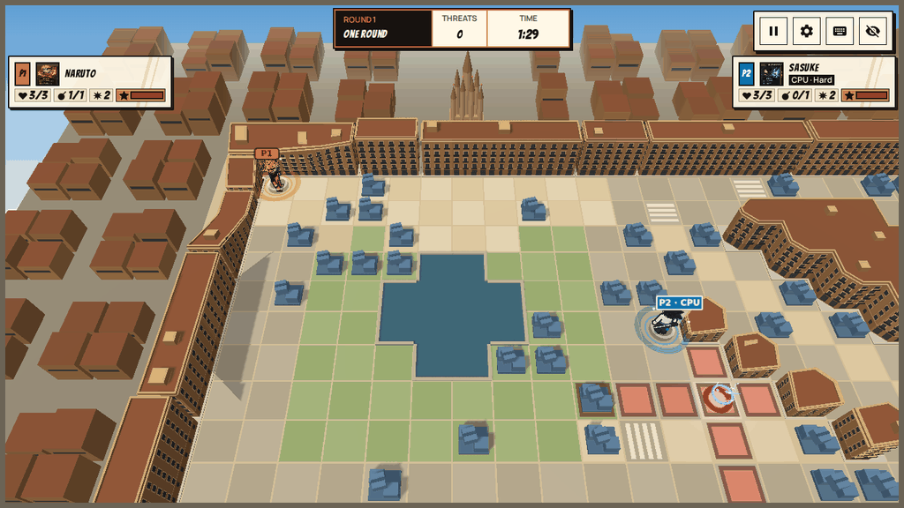
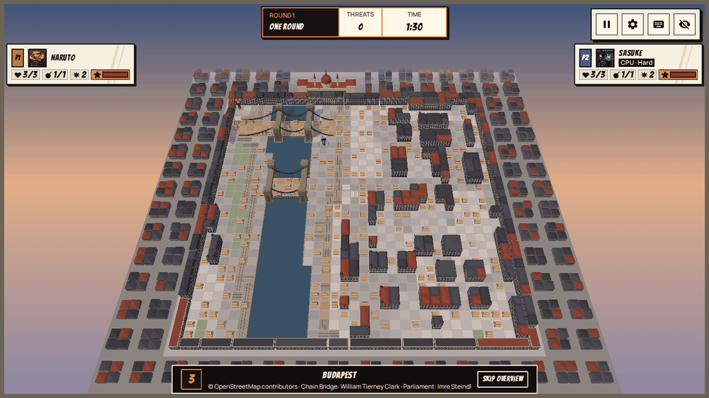
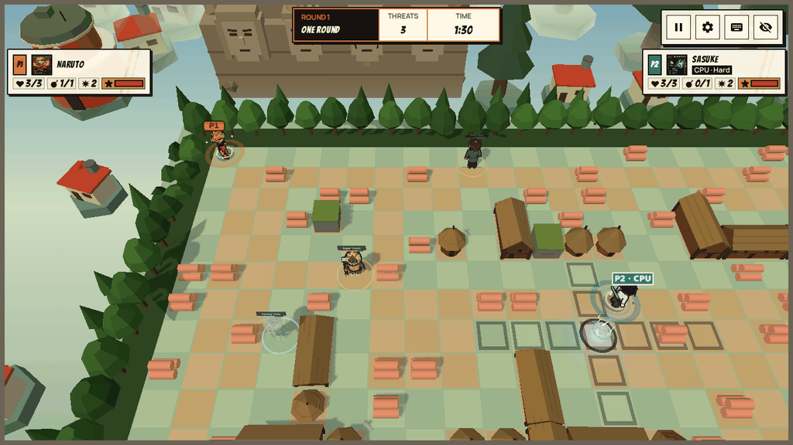
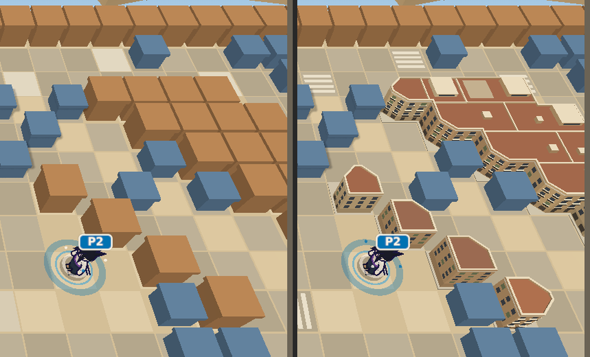

# City Buildings Plan

Written 2026-11-23 against `main` at `cefb5e0`; line numbers refer to that
commit. Today every wall on a city board is the same brown masonry cube, and
every crate a plain cube. This plan makes the inside of the map look like the
city. It rests on a **renderer map** (the code, probed in the test harness and
a production build), a **data survey** (the OSM extracts, traced cell by cell),
a **camera study** (what each height hides, computed with `cameraFraming.ts`)
and a throwaway **prototype** of buildings on all three cities. Numbers are
measured; dev-days are estimates.

## Goal and Hard Rules

City wall cells draw as city blocks with roofs, facades, corners and kerbs.
The border becomes a ring of houses, crates become city objects, and the floor
gets crossings, rails and quay edges, so players know the city from the play
view, not only from the skyline.

1. **Rendering only.** Grid, collision, simulation, protocol and replays stay
   as they are, with no `REPLAY_VERSION` bump. A building is still a `W` cell
   (`REAL_CITY_ARENAS_PLAN.md:80-87`), drawn inside its own cells.
2. **No shader program after GO.** Buildings reuse the wall program; the total
   stays at hiddenLeaf's 17 (`roundEnd.spec.ts:51-64`,
   `cityArena.spec.ts:82-95,150`). Toggling a setting compiles nothing.
3. **Budget.** At most hiddenLeaf's calls + 5 and triangles + 50,000 in the
   same run (`cityArena.spec.ts:148,152`): about 27 calls and 84,000 triangles
   of headroom per city today.
4. **Readability first.** Buildings hide nothing today's walls leave visible;
   walls, crates and floor separate by shape; danger cues and flames keep their
   contrast; nothing animates.
5. **IP.** Stylised massing only: no sculpture, statues, reliefs,
   inscriptions, memorials, arms, flags, ads, or shop, hotel and brand names
   (`REAL_CITY_ARENAS_PLAN.md:650-695,797-810`).
6. **Villages and campaign unchanged.** City styles are keyed by look id, not
   palette. Everything is built in code (`ARCHITECTURE.md:517-520`) under
   `src/view`, out of the server bundle.

## What the Camera Sees

The camera looks down at 54° with a 48° field of view
(`cameraFraming.ts:20-22`), and only the board's +y side is seen (`FRONT`,
`StaticTiles.tsx:96`): real south in Rome, north-east in Barcelona,
south-south-east in Budapest. North faces stay, since the shadow pass renders
back faces (`WebGLShadowMap.js:301`). A roof shows 0.69 of a cell against 0.46
for a 0.94-tall facade, so **roofs, about 60% of what players see, and
camera-facing facades carry the look.**

What one row of buildings hides, from screen centre to the top, across zooms:

| Top height | Floor rows hidden behind it | Player right behind | Player two cells behind |
| --- | --- | --- | --- |
| 0.94 (today) | 0.65–0.98 | 16–35% | 0% |
| 1.2 | 0.87–1.28 | 38–57% | 0% |
| 1.5 | 1.12–1.63 | 63–81% | 0–5% |
| 2.0 | 1.58–2.24 | 100% | 0–47% |

A building hides a whole bomb behind it from a height of 1.15–1.33, and a
head's middle from 1.51–1.68. On the real maps, today's walls hide 1.0–6.7%
of the floor and no bomb tops or heads; uniform 1.2 would hide whole bombs on
up to 2.1% of cells, uniform 2.0 on 2.0–10.3%. Hence:

- **Interior buildings:** the mass stays at 0.80–0.94 wherever floor lies
  north of it: never above today's walls, clearly above a crate (0.66). At
  0.80, hidden feet halve (Barcelona, laptop: 4.8% to 2.6%).
- **Roof features** (attics, stair huts, dormers) may reach 1.05, the villages'
  wall band (`wallStyles.test.ts:34-36`), only where the occlusion test passes.
- **Borders:** the north row and the side columns may reach 2.0. Even 3.0 hid
  nothing extra; 2.0 hides 0.1–1.0 cells of the nearest skyline anchor
  (`stageLooks.ts:370`), 3.0 hides 1.2–2.1. The south row stays at most 0.94,
  since 3.0 there would hide two playable rows.
- **No real heights:** Barcelona's median building would be 1.83 cells tall,
  and a safe cap leaves about ±0.15 of variation, which reads as noise. OSM
  data picks roof and facade styles instead.

## The Approach

| Option | Cost (measured) | Verdict |
| --- | --- | --- |
| A wall shape per look, one per cell, scaled and rotated per instance | 0 draws, 0 programs | Cells cannot see neighbours: no street walls, corners or block roofs. Use it for sudden-death walls |
| **Merged blocks from the mask**, in two merged meshes | +2 draws, 0 programs; Barcelona +11,839 triangles | **Recommended**; prototyped on all three cities |
| Extruded OSM footprints on the board | Real heights break the rules; outlines ignore the cells | No; a far-band option only (`REAL_CITY_ARENAS_PLAN.md:528-535`) |
| Lower or fade buildings near players | Per-frame matrices; or +2 programs in a shader; or a transparent layer, +1 program and unsorted | Deferred: only buildings above the cap need it |

### Buildings From the Mask

Group each map's building (`b`) cells into 4-connected blocks: Rome has 41
cells in 12 blocks (the largest 9 cells), Barcelona 184 in 46 (14), Budapest
158 in 32 (11), and the Rome control 176 in 29 (15).

1. **Shape.** Trace each block, set its walls 0.07 inside the cell edge, and
   stand it on a kerb slab. Cut street corners at 0.34 where all three outside
   cells are `r`, `x`, `t`, `d` or `p`. Split blocks into lots of up to 2x2 by
   a hash of the map id, with party walls. Per-lot heights need real polygon
   clipping: insetting each lot leaves 0.07 nubs at inner corners.
2. **Faces.** Plinth, body, cornice and parapet bands; windows and shopfronts
   on camera-facing faces, windows on east and west faces, none on north faces.
3. **Draws.** Bake each part's RGB colour times its face shade into vertex
   colours, like `bakePart` (`landmarkGeometry.ts:270-298`), and merge into two
   one-instance `InstancedMesh`es with a white instance colour, as the skyline
   does (`StageLandmarks.tsx:66-106,191-206`). The mass casts and receives
   shadows (see the open decisions); the detail only receives.
4. **Material.** Its own object with the wall layer's settings: standard, RGB
   vertex colours, instance colour, front side, opaque, no texture, no flat
   shading. Changing any one adds one or two programs. Not the
   `LANDMARK_MATERIAL` the prototype used: `GameScene3D.city.test.tsx:158,169`
   counts its meshes against the skyline.
5. **Build once**, beside `sceneTileMask` (`arenaScene.ts:57-79`), cached per
   map, look and contrast, never on the `state.map` path
   (`GameScene3D.tsx:2314-2323`). Barcelona took 32 ms, 80 ms with the border.
   `buildStaticTileLayers` skips building cells in `wallVisible`, like the gate
   branch (`staticTiles.ts:329-333`); the prototype's wiring was 31 lines.

City walls never change mid-match, so a static mesh is safe: the spawn carve
opens none (`arenaMaps.test.ts:196-201`), and sudden death only adds walls
where there were none (`suddenDeath.ts:41-50`), which stay cubes in
`wallVisible`. Border cells never change, so they can join the buildings.

### Crates, Streets and Landmarks

- **City crates.** Barcelona has 237 crates and Rome 269, and beside detailed
  buildings plain cubes look foreign. Give each look a crate shape where
  `TILE_SHAPES.crate` is chosen (`StaticTiles.tsx:253,413`): slatted market
  crates, dig-site crates under canvas, strapped freight crates. Vertex colours
  stay shade only, so the tints and player obstacles still work. Keep the 0.72
  by 0.66 box, and no plank detail on buildings: walls and crates can be
  equally bright (1.00:1 in Rome).
- **Floor marks**, flat, in the detail mesh: the city plan's phase 1a mask
  detail (`REAL_CITY_ARENAS_PLAN.md:491-493`). Zebras on `x` cells (Rome 11,
  Barcelona 54, Budapest 4); tram rails traced along each line of `t` cells
  (Rome 67, Budapest 71), since per-cell rails looked like broken ladders; deck
  edges on Budapest's 60 `d` cells; kerbs.
- **Water.** Quay rims and bollards where water cells meet floor (Budapest has
  145 water cells, Barcelona 12), and two generic boats on Budapest's kept
  water. No prop stands on a floor cell; trees go on the border or off the
  board.
- **On-board landmarks.** Rome's signature is the Colosseum, not its 41
  building cells: draw its 32 `m` cells as a stylised arched ring in today's
  landmark tint `#a68c68`, three tiers of flat arch panels facing the camera,
  no statues or inscriptions (Italy has no freedom of panorama,
  `REAL_CITY_ARENAS_PLAN.md:803`). Budapest's 4 `m` cells become plain Chain
  Bridge towers, no lions, credited to William Tierney Clark. Both merge into
  the building meshes and keep the height rules.

### Settings

- **Scenery off** (default on low-end devices, `gamePreferences.ts:91`): the
  mass draws, as it is the wall, and the detail hides. Nothing compiles
  (`GameScene3D.scenery.test.tsx:85`).
- **High contrast:** first, today's walls on building cells, the tested look.
  In phase 7, a variant at the wall role's lightness (`highContrast.ts:67-74`),
  without detail, with a light rim on each roof's north edge; the danger
  telegraph is already only 1.01–1.11:1 against a high-contrast wall top.
- **Reduced motion:** buildings are static: no lit windows, no moving trams.

## Per-City Look

Facades start from each city's wall colour (`cityColors.ts:39,58,77`), with
roof and trim colours from its skyline (`stageLooks.ts:338,357,393`). The
palettes are the data survey's; the colour rules decide what ships.

**Barcelona (Eixample).** 184 building cells in 46 blocks.

- Street walls: a block's cells close today's 0.17 gap between wall boxes
  (`StaticTiles.tsx:92`), with thin party-wall seams between lots.
- One height per block; flat clay-tile terraces with a pale parapet; stair huts
  or water tanks by hash; set-back attics where `roofLevels` is 1 or more.
- Camera-facing facades with tall window bays, balconies on every floor and
  shutters. Chamfers where the grid kept a corner open (10 of 41), with a 45°
  kerb. With the layer: real lots (88 buildings, 66 owner changes) and a
  courtyard floor `#e3cdb0` on hollowed interiors (61% built over in OSM).
- Palette: facades `#b3855a` (today's wall), `#a87b52`, `#9f7550`; roof tile
  `#a5633f` (darken, rule 2); parapet `#d9b88a`; window `#4a3a30`, railing
  `#3a3532`, shutter `#5d6b55` (rule 3). Crates keep `#5b7fa8`.
- Avoid: Modernista mosaics and curves, the basilica's facade sculpture
  (`REAL_CITY_ARENAS_PLAN.md:807`), the flower tile, balcony flags, signs.

**Rome (Colosseum).** Only 41 building cells; the ring, the border and 488 park
cells carry the look.

- The Celio blocks (`cities.py:31-32`): low hipped terracotta roofs, a few flat
  terraces, ochre and rust stucco, green shutters. Brick ruins on 13 cells:
  jagged tops, no roof, never below 0.80, even where OSM says `height=0.3`.
- Umbrella pines on the border and off the board; faint cobbles on plaza and
  road, as 28% of the street area is `sett`.
- Palette: stucco `#a9664a` (today's wall), `#a26a40` (darken, rule 2),
  `#9e5d4a`; roof `#9c5236`, ridge `#86462f`; brick `#9a5a43`; travertine trim
  `#d8cbb0`; shutter `#55634a`; pine `#41553a` on `#5b4634` (the skyline
  cedar). Crates keep `#8d6e86`.
- Avoid: arcade statues, the Arch of Constantine's reliefs, inscriptions,
  religious statuary, the Vittoriano's sculpture and altar
  (`REAL_CITY_ARENAS_PLAN.md:122-124`).

**Budapest (Chain Bridge).** 158 building cells, none in the spawn view, so the
border, the embankment and the bridge carry the play view.

- Roofs: hipped slate `#4e5163`, zinc ridges `#3f4250`. With the layer: hipped
  on 39 cells, flat 22, gabled 19, gambrel 8; some red tile `#8f4a3f` (the
  Parliament's trim); dormers where `roofLevels` is 1 or more; palaces on the
  51 cells dated 1825–1913, and the two 1980s hotels (18 cells) as plain slabs.
- Dusk windows, about 30% `#e9cf9c` and the rest `#3b3d4b`, baked with no glow
  (rule 3). Granite rim `#8a8577` and bollards on the embankment. The yellow
  tram, with no livery, stands off the board (rule 2).
- Palette: facades `#7b7d90` (today's wall), `#7f7a6d`, `#77738a`, `#6f7284`.
  Crates keep `#c79f76`.
- Avoid: the bridge's lions, Gresham Palace's ironwork and mosaics, rooftop
  statues, arms and flags, hotel and brand names, memorials. Credit the
  architect of any palace modelled closely enough to be recognised
  (`REAL_CITY_ARENAS_PLAN.md:809`).

### Colour Rules

Tested in both modes against every floor tone, checker shades included:

1. **As dark as today.** Each main facade and roof colour keeps at least the
   floor contrast its cell has today: walls 1.73:1 in Rome, 1.31:1 in
   Barcelona, 1.55:1 in Budapest. The palettes above pass. The prototype's
   light facades (1.00–1.35:1) fail, so its screenshots show the shapes, not
   the colours that ship.
2. **Away from flame orange.** Nothing sits closer to the flame emissive
   `#ff8a00` (`GameScene3D.tsx:260`) than ΔE 52.9 (CIELAB, as the camera study
   measures), today's closest wall, Barcelona's `#b3855a`. That fails
   Barcelona's roof tile `#a5633f` (50.5), Rome's stucco `#a26a40` (50.9), the
   tram's `#e8b23a` (31.7) and the prototype's Rome palette (39–51).
3. **Quiet facades.** Windows and trim stay within 1.5:1 of their facade, and
   nothing glows, because the camera-facing facade is the backdrop for the
   players, flames and pickups in front of it. The palettes' dark windows fail
   (Barcelona's `#4a3a30` is 3.3:1); see the open decisions.
4. **High contrast** keeps its rules (`cityMask.test.ts:166-191`).

## Data: The Buildings Layer

Phases 1–5 need only the mask. The layer adds real lots and roof styles; build
it only if the playtest keeps the OSM pipeline
(`REAL_CITY_ARENAS_PLAN.md:232-250`).

`loc['building']` already holds every footprint in board cells, with tags and
OSM id (`build.py:448`). A `buildings_layer.py` of about 80 lines, run after
the writes at `build.py:562-564` when `cities.py` lists a `buildings` output,
writes `public/maps/city/<id>.buildings.json`. Each building gets its OSM id,
cells, `levels` and their source (`levelsFrom`) and `kind`, plus `roofShape`,
`roofLevels`, `roofColour`, `colour`, `material`, `built`, `ruin` and `edge`
where tagged. Hollowed interiors travel as `courts` (`build.py:522-523`), so
the mask alphabet stays. On a patched copy every grid, mask and raw file
rebuilt identical, and the files came to 2.9–12.2 KB.

| On building cells | Rome | Barcelona | Budapest |
| --- | --- | --- | --- |
| OSM owner | 41 of 41 | 184 of 184 | 156 of 158, 2 from a neighbour |
| Buildings (cells each) | 20 (2.1) | 88 (2.1) | 41 (3.9) |
| Owner has `building:levels` | 22% | 40% | 80% |
| `roof:shape` / `roof:levels` / `start_date` | 7% / 7% / 0 | 0 / 10% / 0 | 56% / 42% / 48% |
| Border cells mostly on one building | 21 | 80 | 45 |

- **Fallbacks.** No cell has a colour tag, so colour comes from the palette,
  varied by a hash of the OSM id. Roofs are flat in Barcelona and hipped in
  Rome (none on ruins); in Budapest the tag, then `start_date` (hipped before
  1914, flat after 1950), then hipped. Levels come from a neighbour, the
  type's median or the city median; they set only 2–3 steps inside 0.80–0.94,
  and window rows. Rule-made walls take a neighbour's building; other border
  cells get a hedge, railing or parapet.
- **Props** were never fetched (the query takes only ways and relations,
  `tools/city/*/meta.json:10`), and a refetch overwrites the extracts
  (`tools/city/prototype/README.md:39-43`). Place them by rule.
- **The file** loads from a view-only module, since the server bundle reaches
  `arenaMaps.ts` (`server/onlineServer.ts:11` to `monsterSpawns.ts:5`). It is
  ODbL data, so `public/maps/city/NOTICE.txt` must list it. It ships no names:
  75% of Budapest's building cells are named, some as hotel brands.

## Build Status (2026-11-24)

Built: phases 1-4 and the quays from phase 5 for all three cities and the
control, plus the village arenas, after playtest feedback that the first
blocks read as building blocks, not as the city.

- Taller buildings. Bodies reach 2.1 and features 2.5 (`BODY_CAP`,
  `FEATURE_CAP`). Barcelona has flat terraces, xamfrans and balconies on
  every floor. Rome has hipped tile roofs, green shutters and first-floor
  balconies. Budapest has slate mansards with dormers, pilasters and corner
  turrets. Every city has framed dark windows, cornices and string courses.
- A cut-away replaces the 0.94 cap. The cells from the row of each
  fighter, bomb, cell a bomb's blast will cross, blast, pickup, monster, boss
  and hazard in sight, to two rows toward the camera and a column either
  side, sink to 0.36 of their height (at most 0.9). They ease over a sixth of a second,
  or snap under reduced motion. The border row nearest the camera stays at
  0.94. Tested: every vertex in front of a focus is under 0.94 once sunk, and
  exact again at full height.
- On-board landmarks (phase 4). Budapest's Chain Bridge has two stone
  towers, each a pair of pylons with the blind arch facing the camera and a
  lower arched crossing. It has double chains swinging from the banks over
  both towers, hangers, iron railings and girders. The second bridge
  downstream gets the same towers, on the river cells either side of its
  deck, so the two read as one city's bridges. Rome's Colosseum has three
  arcade tiers and an attic. The landmark stones pass the floor rule.
- Quays (phase 5): stone rims inside the water cells along every bank.
- Crates as goods (phase 3, after the design review): Barcelona taped boxes
  on a pallet, Rome produce crates under a striped awning, Budapest and
  Stone casks, Leaf log piles, Sand jars, Cloud barrels, Mist and hideout
  lashed crates. None copies a wall's shape, and each stays under 100
  triangles. They are no taller than today's crate and keep a gap to the next
  cell. Vertex colours are shade only, so the crate colour, the broken and
  explored tints and player obstacles still show.
- Village arenas, after `src/assets/ninja-bomber-stage-atlas.png`:
  - Leaf: a forest ring, thatched timber houses, round huts, mossy stones,
    dirt paths, and huts for crates.
  - Sand: rock outcrops, flat adobe with beam ends, and domes.
  - Mist: grey-blue rock, stone houses and blue domes.
  - Cloud: moss-roofed stone shrines.
  - Stone: rock mesas and stone houses.
  - Akatsuki hideout: stalagmite spires and dark stone with lantern-red
    openings.
  - The war front keeps its palisade.
  - The same villages dress online rooms, training and the campaign, built
    from each match's map. The campaign keeps its boss gates and its village
    square (with the square's own dressing) as before. Under its fog a house
    or tree shows once any of its cells is explored, darkened until in sight,
    and is gone while hidden.
  - Each village's colours pass the cities' floor and flame rules against
    its own floor (`villageBuildings.test.ts`).
  - The border ring is one continuous edge (`villageBorder.ts`): cliff runs
    with a wandering top, strata, boulders and a lip (grass on Cloud, moss on
    Mist), Leaf's overlapping crowns with conifers behind that overhang only
    outward, and the hideout's stalagmites.
- Windows are now dark glass, darker than every facade and as far from
  flame orange as the walls. This replaces colour rule 3's tone-on-tone.
- Two draws on the wall program, checked in the scene test for a city and a
  village. In the browser, every city and village keeps 17 programs and links
  none after GO.
- The budget test still measures cities against Hidden Leaf, which now draws
  its village too (about 80,000 triangles, up from 69,000). Cities run at
  about 73,000-87,000.
- High contrast keeps today's walls everywhere, and so does a tab that
  opened the Mission Deck with `?playtest=1`.

- Outskirts past the board (`cityOutskirts.ts`): two-by-two blocks of low
  roofs on street-level ground round the floor slab, up to 1.4 behind the
  board, lower at the sides and at most 0.5 on the camera's side. They keep
  the famous place's footprint and the sky behind it clear. They replace the
  filler props (terrace blocks, quarry steps, piers), so a city no longer
  floats, and the scene's fog fades the far rows.

Not yet: the buildings layer from real lots (phase 6), a high-contrast
variant (phase 7), and boats and bollards.

## Phases

Each phase ends in something playable, with screenshots both owners review
beside `main`: the spawn view at 1366x768 and on a Pixel 7, the overview,
scenery off, high contrast, and a blast and a pickup in front of a facade.
Sizes are our estimates for production code with tests; the prototype was
about 1,000 throwaway lines.

| Phase | Delivers, and what you can then see | Accepted when | Dev-days |
| --- | --- | --- | --- |
| 1. Barcelona's blocks | Groundwork: `PerfProbe` counts the shadow pass, the budget test samples the overview too, occlusion and colour test helpers. Then Barcelona's blocks: outlines, kerbs, corners, lots, terraces, facades, zebras, the setting fallbacks and a dark-window variant for the A/B, behind a URL flag until the playtest has run. You see Barcelona's street blocks in play and in the overview, in the shipping palette | Every building cell is covered, and no vertex leaves its block's cells. Mass tops are 0.80–0.94, roof features at most 1.05. The occlusion test (the camera study's method on `cameraFraming.ts`, lone-player aims over the spawn block) finds nothing hidden that today's walls leave visible. The colour rules pass. High contrast draws today's walls; scenery off hides only the detail | 3–5 |
| 2. Border ring, Rome and Budapest | Border houses in runs of 2–5 on all three cities, with the 2.0 north and side trial; Rome's hipped roofs, stucco and ruins; Budapest's slate roofs and dusk windows. Every city is framed by houses | Border cells are covered. The south border is at most 0.94, the others at most 2.0. The hero landmark's top stays visible from every spawn framing (extend `landmarkPlacement.test.ts:113-140`) | 3–5 |
| 3. City crates | A crate shape per look, so crates read as city objects | Each shape fits the 0.72 by 0.66 box with grey vertex colours; the tints and player obstacles still show | 2–3 |
| 4. On-board landmarks | The Colosseum ring and the bridge towers: Rome's signature on the board | The ring covers exactly Rome's 32 `m` cells and the towers Budapest's 4, with no extra draw, inside the height and occlusion tests | 2–4 |
| 5. Street level and water | Rails along the lines, deck edges, kerbs, cobbles, quay rims, bollards, boats | Marks stay flat and only on their class's cells; each rail piece joins a neighbouring `t` cell | 3–4 |
| 6. Buildings layer, if the pipeline survives | The emitter, the notice and the view-only loader; real lots, roof shapes, attics, dormers, palaces and slabs, courtyards | Every grid, mask and raw file rebuilds identical; the layer holds no names; `NOTICE.txt` lists it; the server bundle lacks it | 3–5 |
| 7. High contrast and devices | The retoned variant and roof rims; a frame-time check on the oldest phone | In high contrast every building colour is at least 3:1 against every floor (as `cityMask.test.ts:175-191` asks of walls), and danger cues at least 1.5:1 against roofs. The frame-time budget holds on the named phone (`REAL_CITY_ARENAS_PLAN.md:709`) | 1–2 |

About 17–28 dev-days. Phases 1–3 (8–13) carry most of the change: in the
prototype, the border ring and the crates mattered as much as the blocks.
Later, if wanted: fronts rising to 1.68 inside continuous east–west rows
(11–16% of interior walls, which hide nothing extra there), taller blocks
where two wall rows lie north (10, 20 and 36 cells), and fighter silhouettes.

## Acceptance Tests

Each phase's own tests are in the table above. Every phase also passes these:

- The budget test (`cityArena.spec.ts:119-155`) passes for every city, in play
  and in the overview, with the shadow pass counted.
- No program links after GO (`roundEnd.spec.ts:51-64`,
  `cityArena.spec.ts:82-95`), even after toggling scenery and high contrast;
  building meshes share the wall program (a test like
  `GameScene3D.city.test.tsx:120-143`).
- Villages and the campaign render as before (`wallStyles.test.ts:14-41`,
  `staticTiles.test.ts:47-207`, `cityMask.test.ts:82-91,128-142`), hiddenLeaf's
  numbers match `main` under the same probe, and the skyline caps hold
  (`landmarkPlacement.test.ts:182-186`, `GameScene3D.city.test.tsx:158,169`).
- Geometry is built once per map, so bombs and broken crates do not rebuild
  it, and the same mask always gives the same geometry.
- Both owners have reviewed the screenshot set named under Phases.

## Risks and Open Decisions

| Decision | Recommended | Because | Alternative |
| --- | --- | --- | --- |
| Timing | Run playtest step 5 first, or keep buildings behind a flag that stays off for it | The control has 176 building cells to Rome's 41; with buildings it looks more like a city than Rome, which tilts "Which one is laid out like the real Rome?" | Accept the bias and record it with the results |
| Shadows | The mass casts, the detail does not; narrow plan line 707 to skyline scenery | Today's walls cast, and the shadow window sits over the spawns. Cost in Barcelona: 1 call, 2,857 triangles | Cast none: buildings look flatter than the crates beside them |
| Window contrast | Tone-on-tone (rule 3), then an A/B against dark windows with blasts and pickups in front | Readability first, though dark windows were the prototype's strongest city cue | Dark windows, if flames and pickups still read |
| Border height | North and side borders up to 2.0, south at most 0.94 | No extra occlusion; at most 1 cell of the skyline anchor hidden | The whole border at wall height |
| Crate colours | Keep them; change the shape | They carry the tested readability rules | Retint after review, re-running the contrast tests |
| Buildings layer | Only if the playtest keeps the OSM pipeline | Mask-only buildings also suit hand-made maps | Build it now |
| Props | By rule, on the border and off the board | Nodes were never fetched; a refetch overwrites the extracts | Refetch with node queries |

- **A stray program:** a plain `Mesh`, RGBA colours, transparency, a texture or
  flat shading each add one; instancing without instance colour adds two.
- **The probe undercounts.** three 0.160.1 renders shadows
  (`WebGLRenderer.js:1201`) before resetting `renderer.info` (`:1207`), and
  neither the app nor R3F 8.18.0 turns `autoReset` off, so `PerfProbe` misses
  the shadow pass, whatever `PerfProbe.tsx:39-40` says. Phase 1 sets
  `autoReset = false` and resets after each read; every baseline then rises.
- **Height creep:** the prototype peaked at 1.083–1.185; the tests stop it.
- **Phone cost:** the 11–80 ms build and the frame time are unmeasured on a
  phone. Build at load, and check in phase 7.
- **Small blocks:** Barcelona's 3–7-cell corner pieces between crate fields
  read as pavilions. That is the gameplay pass's choice; looks never change it.
- **Few shadows:** three's default shadow camera covers 118 of 1,225 cells
  (`DirectionalLightShadow.js:8`); widening it is a separate change.

## Evidence

Barcelona's play view, close up: today's wall cubes (left) and the prototype's
merged blocks with terraces, parapets, window bands, cut corners and zebras
(right). The prototype used its own palette and heights, which break colour
rules 1 and 2 and the height cap, so it shows the shapes, not the colours that
ship. The prototype code, its other screenshots (Rome, Budapest, the border
ring), the renderer probes, the camera study and the data survey are kept
outside the repo with the city prototype.

PerfProbe after GO (shadow pass left out), production build, SwiftShader at
1366x768, highest of 3 samples, one run:

| Map | Build | Calls | Triangles | Programs | Linked after GO | Mass / detail triangles | Build | Highest top |
| --- | --- | --- | --- | --- | --- | --- | --- | --- |
| hiddenLeaf | both | 54 | 68,875 | 17 | 0 | – | – | – |
| Barcelona | `main` | 32 | 34,711 | 17 | 0 | – | – | 0.94 |
| Barcelona | building cells | 34 | 46,550 | 17 | 0 | 7,273 / 8,982 | 32 ms | 1.083 |
| Barcelona | plus border | 33 | 55,203 | 17 | 0 | 12,288 / 15,884 | 80 ms | 1.087 |
| Rome | `main` | 31 | 32,442 | 17 | 0 | – | – | 0.94 |
| Rome | building cells | 33 | 34,224 | 17 | 0 | 954 / 1,812 | 11 ms | 1.090 |
| Rome | plus border | 33 | 39,545 | 17 | 0 | 4,423 / 6,928 | 44 ms | 1.145 |
| Budapest | `main` | 32 | 32,601 | 17 | 0 | – | – | 0.94 |
| Budapest | building cells | 34 | 39,246 | 17 | 0 | 3,095 / 7,342 | 41 ms | 1.185 |

The deltas are exact: Barcelona's +11,839 is 7,273 + 8,982 − 4,416 (184 walls
of 24 triangles). The shadow pass adds 1 call and 2,857 triangles more, or
4,608 and no call with the border. Barcelona's overview drew 35 calls and
47,054 triangles (34 and 55,707 with the border).
